# ggheatmapper: Tile-able heatmaps that play well with ggplots

## Introduction

`ggheatmapper` is built using `ggplot2` and the `patchwork` framework
for aligning plots. It supports adding into the heatmap and all the
powerful tweaks enabled by `theme`s in ggplot, and helps you align more
information about your data to the original heatmap to make “complex
heatmaps” with a more modern and *tweakable* framework.

## Using a matrix as your table

The simplest, yet less powerful, way to use `ggheatmapper` is with a
matrix as-is. Here, we demonstrate with a subset of a gene expression
matrix for bladder cancer samples:

``` r
library(tidyverse)
#> ── Attaching core tidyverse packages ──────────────────────── tidyverse 2.0.0 ──
#> ✔ dplyr     1.2.0     ✔ readr     2.2.0
#> ✔ forcats   1.0.1     ✔ stringr   1.6.0
#> ✔ ggplot2   4.0.2     ✔ tibble    3.3.1
#> ✔ lubridate 1.9.5     ✔ tidyr     1.3.2
#> ✔ purrr     1.2.1     
#> ── Conflicts ────────────────────────────────────────── tidyverse_conflicts() ──
#> ✖ dplyr::filter() masks stats::filter()
#> ✖ dplyr::lag()    masks stats::lag()
#> ℹ Use the conflicted package (<http://conflicted.r-lib.org/>) to force all conflicts to become errors
library(patchwork)
library(ggheatmapper)

data(tcgaBLCA_ex)
gexp <- tcgaBLCA_ex$gexp

gghm <- ggheatmap(gexp,
          hm_colors = 'RdBu',
          hm_color_values = scales::rescale(c(-4,-2,-1,-0.5,-0.25,0,0.25,0.5,1,2,4,6)),
          scale = TRUE,
          center = TRUE,
          show_dend_row = TRUE,
          colors_title = "Scaled expression (log2 UQ)",
          show_colnames = FALSE)
#> Running `ggheatmap` in matrix mode. If that's not intentional, provide a `colv`.
gghm
```

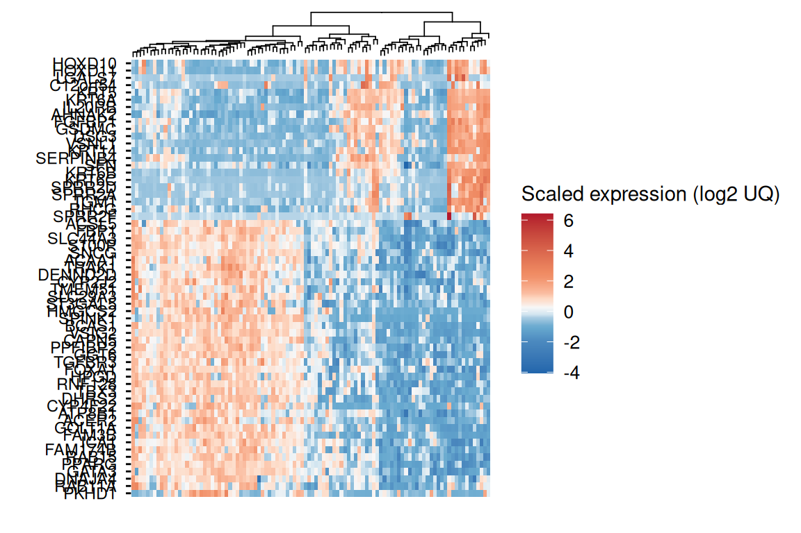

This method still will support extending with `align_to_hm` but would
not support `add_tracks`. You can still modify this by using `&` and
adding `theme`, for example:

``` r
gghm &
  theme(axis.text = element_text(size = 6))
```

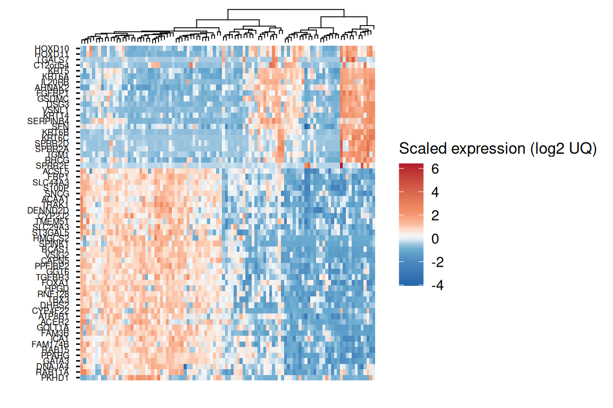

## Using tables with more variables

If transpose our original table and extended it with new variables, we
can unlock more features using `ggheatmap`.

``` r
sample_annot <- tcgaBLCA_ex$sample_annot %>% as_tibble()
genes <- rownames(gexp)
tcgaBLCA_tb <- gexp %>%
  t() %>%
  as.data.frame() %>%
  rownames_to_column("sample") %>%
  left_join(sample_annot, by = "sample") %>%
  tibble() %>%
  group_by(consensusClass)
head(tcgaBLCA_tb)
```

| sample           | FBP1 | ACER2 | PKHD1 | CAPN5 | S100P | TMEM51 | DHRS2 | CYP4F22 | SPINK1 | ACSL5 | ST3GAL5 | TBX3 | HPGD | TGFBR3 | FAM3B | ATP8B1 | RNF128 | SNCG | SLC44A3 | GATA3 | PPARG | ICA1 | GGT6 | RAB11A | TRAK1 | VSIG2 | BCAS1 | RAB15 | FAM174B | SLC29A3 | FOXA1 | GOLT1A | PPFIBP2 | DENND2D | ACAA1 | DNAJA4 | HMGCS2 | CYP2J2 | VSNL1 | KRT14 | TGM1 | SERPINB4 | GSDMC | KRT6A | LGALS7 |   SFN | SPRR2A | C12orf54 | SPRR2D | HOXD11 | KRT6C |  KRT5 |  DSG3 | KRT6B | HOXD10 | IL20RB | RHCG | AHNAK2 | SPRR2F | FGFBP1 | sex | age | stage | node | metastasis | papillary | squamous | neuroendocrine | plasmacytoid | consensusClass | cor_pval | separationLevel | LumP | LumNS | LumU | Stroma.rich | Ba.Sq | NE.like |
|:-----------------|-----:|------:|------:|------:|------:|-------:|------:|--------:|-------:|------:|--------:|-----:|-----:|-------:|------:|-------:|-------:|-----:|--------:|------:|------:|-----:|-----:|-------:|------:|------:|------:|------:|--------:|--------:|------:|-------:|--------:|--------:|------:|-------:|-------:|-------:|------:|------:|-----:|---------:|------:|------:|-------:|------:|-------:|---------:|-------:|-------:|------:|------:|------:|------:|-------:|-------:|-----:|-------:|-------:|-------:|:----|----:|:------|:-----|:-----------|:----------|:---------|:---------------|:-------------|:---------------|---------:|----------------:|-----:|------:|-----:|------------:|------:|--------:|
| TCGA-XF-A9SW-01A | 3.05 |  0.76 |  1.03 |  3.19 |  7.25 |   4.70 |  3.55 |    0.05 |   8.07 |  5.22 |    2.77 | 4.85 | 4.20 |   5.32 |  3.18 |   4.28 |   3.18 | 4.84 |    2.01 |  5.84 |  4.21 | 2.77 | 3.73 |   5.85 |  4.84 |  3.28 |  0.94 |  4.78 |    3.52 |    3.21 |  2.99 |   3.28 |    2.47 |    3.20 |  3.77 |   3.68 |   0.35 |   0.72 |  0.69 |  0.83 | 0.52 |     0.02 |  1.32 |  0.29 |   0.00 |  6.26 |   1.28 |     0.39 |   0.26 |   0.11 |  0.02 |  1.85 |  0.00 |  0.00 |   0.37 |   0.51 | 1.88 |   5.66 |   0.00 |   0.09 | M   |  85 | T3    | N2   | NA         | 0         | 0        | 0              | 0            | Stroma-rich    |        0 |            0.89 | 0.39 |  0.49 | 0.46 |        0.64 |  0.50 |    0.30 |
| TCGA-BL-A13J-01B | 2.54 |  4.44 |  0.25 |  2.98 |  4.28 |   2.69 |  8.25 |    1.73 |   3.90 |  4.77 |    3.27 | 5.75 | 5.67 |   4.00 |  1.64 |   5.60 |   5.50 | 1.40 |    3.26 |  5.05 |  5.20 | 3.54 | 2.44 |   5.45 |  5.44 |  3.10 |  1.81 |  3.59 |    3.94 |    1.39 |  2.46 |   1.37 |    3.78 |    3.21 |  3.22 |   6.41 |   2.18 |   2.95 |  0.06 |  3.60 | 0.97 |     0.44 |  0.66 |  2.77 |   0.00 |  4.00 |   1.01 |     0.02 |   0.70 |   0.55 |  0.04 |  4.68 |  1.38 |  0.23 |   1.15 |   1.00 | 2.35 |   4.59 |   0.01 |   0.69 | M   |  65 | T4    | N2   | M0         | 1         | 0        | 0              | 0            | LumP           |        0 |            0.90 | 0.54 |  0.50 | 0.50 |        0.50 |  0.50 |    0.18 |
| TCGA-C4-A0F1-01A | 1.53 |  2.04 |  3.09 |  2.47 |  4.09 |   3.34 |  4.32 |    0.23 |   1.80 |  1.61 |    0.88 | 2.23 | 1.05 |   1.60 |  0.15 |   4.38 |   3.06 | 0.99 |    2.79 |  4.21 |  1.74 | 2.46 | 1.02 |   6.65 |  5.36 |  0.13 |  0.23 |  1.56 |    1.52 |    2.19 |  0.26 |   0.00 |    2.59 |    3.75 |  4.85 |   5.69 |   0.00 |   2.57 |  5.99 | 14.13 | 1.57 |     8.68 |  4.12 | 13.87 |   0.35 | 10.49 |   4.81 |     0.59 |   5.03 |   3.53 | 10.41 | 13.90 | 10.78 | 11.85 |   4.11 |   8.15 | 6.86 |  10.17 |   0.45 |   6.46 | M   |  71 | T3    | N0   | M0         | 0         | 1        | 0              | 0            | Ba/Sq          |        0 |            0.82 | 0.30 |  0.23 | 0.24 |        0.34 |  0.66 |    0.16 |
| TCGA-BT-A20W-01A | 5.98 |  5.05 |  1.22 |  4.92 |  7.03 |   4.97 |  8.03 |    5.10 |   8.85 |  6.83 |    5.15 | 7.44 | 6.54 |   4.24 |  4.19 |   5.45 |   5.89 | 8.17 |    4.01 |  7.77 |  6.57 | 4.64 | 6.23 |   6.77 |  6.24 |  5.85 |  5.15 |  5.89 |    4.00 |    4.61 |  5.48 |   2.97 |    5.58 |    4.92 |  5.44 |   5.72 |   6.61 |   2.79 |  0.13 |  2.54 | 0.93 |     0.00 |  0.29 |  0.92 |   0.00 |  5.65 |   0.03 |     0.11 |   0.11 |   0.56 |  0.01 |  2.13 |  0.07 |  0.09 |   0.80 |   0.74 | 0.43 |   1.30 |   0.00 |   0.18 | M   |  71 | T2    | N0   | M0         | 0         | 0        | 0              | 0            | LumU           |        0 |            0.03 | 0.74 |  0.74 | 0.74 |        0.62 |  0.47 |    0.30 |
| TCGA-GV-A40G-01A | 6.03 |  3.95 |  2.84 |  7.06 |  6.68 |   5.81 |  4.73 |    5.15 |   9.80 |  3.99 |    3.85 | 7.19 | 6.64 |   4.67 |  4.33 |   5.30 |   6.73 | 8.50 |    3.68 |  5.84 |  5.94 | 4.54 | 5.71 |   7.32 |  6.19 |  5.82 |  5.03 |  6.16 |    4.88 |    4.51 |  4.80 |   2.76 |    5.33 |    4.64 |  5.96 |   5.69 |   5.13 |   2.46 |  0.12 |  2.34 | 1.63 |     0.37 |  0.24 |  0.22 |   0.01 |  6.64 |   0.17 |     0.15 |   0.08 |   0.75 |  0.02 |  2.47 |  0.00 |  0.08 |   1.20 |   0.68 | 1.40 |   0.20 |   0.00 |   0.78 | M   |  77 | T2    | N0   | NA         | 0         | 0        | 0              | 0            | LumU           |        0 |            0.07 | 0.67 |  0.62 | 0.68 |        0.49 |  0.42 |    0.26 |
| TCGA-HQ-A2OE-01A | 5.56 |  5.36 |  3.59 |  5.41 |  7.05 |   5.54 |  6.58 |    1.12 |   7.46 |  6.39 |    5.25 | 9.16 | 8.11 |   5.06 |  6.35 |   7.09 |   5.70 | 7.77 |    4.64 |  7.43 |  6.04 | 3.52 | 4.55 |   7.05 |  6.51 |  4.41 |  5.14 |  6.47 |    4.27 |    4.65 |  7.29 |   5.72 |    6.04 |    5.58 |  5.17 |   5.51 |   9.23 |   7.13 |  0.01 |  0.68 | 0.74 |     0.08 |  0.34 |  0.57 |   0.00 |  8.06 |   0.10 |     0.20 |   0.93 |   0.01 |  0.01 |  4.42 |  0.65 |  0.16 |   0.26 |   0.55 | 1.18 |   0.40 |   0.00 |   0.13 | M   |  69 | T2    | N2   | NA         | 1         | 0        | 0              | 0            | LumP           |        0 |            0.31 | 0.63 |  0.56 | 0.59 |        0.43 |  0.41 |    0.24 |

One of the additional features we unlock is using `grouping` with
`group_by` to make semi-supervised heatmaps. In this case, we need to
say which column contains the IDs that will be the *columns* of the
heatmap (in this case, `colv = 'sample'`), and what are the columns we
want to plot as *rows* (`rowv = genes`). Other parameters here are
graphical, for demonstration:

``` r
gr_gghm <- ggheatmap(tcgaBLCA_tb,
    colv = "sample",
    rowv = genes,
    hm_colors = 'RdBu',
    hm_color_values = scales::rescale(c(-4,-2,-1,-0.5,-0.25,0,0.25,0.5,1,2,4,6)),
    scale = TRUE,
    center = TRUE,
    show_dend_row = FALSE,
    show_colnames = FALSE,
    show_rownames = FALSE,
    group_colors = c(`Ba/Sq` = "#fe4a49", LumNS = "#32837d", LumP = "#06d6a0", LumU = "#009fb7",
                     `Stroma-rich` = "#f9c80e", `NE-like` = "#7d5ba6"),
    colors_title = "Scaled expression (log2 UQ)")

gr_gghm +
  plot_layout(guides = 'collect')
```

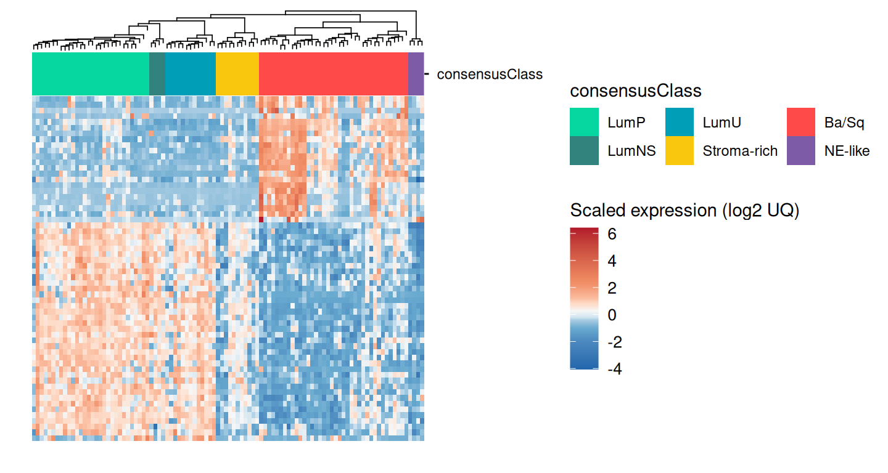

Here, we can see that the heatmap is clustered in a semi-supervised
manner (by `consensusClass`). It also enables `add_tracks`:

### Adding tracks

You can `add_tracks` for variables that were in the original table fed
to `ggheatmap`. You can see what variables are available using
`get_data`:

``` r
get_data(gr_gghm) %>% colnames()
#>  [1] "observations"    "FBP1"            "ACER2"           "PKHD1"          
#>  [5] "CAPN5"           "S100P"           "TMEM51"          "DHRS2"          
#>  [9] "CYP4F22"         "SPINK1"          "ACSL5"           "ST3GAL5"        
#> [13] "TBX3"            "HPGD"            "TGFBR3"          "FAM3B"          
#> [17] "ATP8B1"          "RNF128"          "SNCG"            "SLC44A3"        
#> [21] "GATA3"           "PPARG"           "ICA1"            "GGT6"           
#> [25] "RAB11A"          "TRAK1"           "VSIG2"           "BCAS1"          
#> [29] "RAB15"           "FAM174B"         "SLC29A3"         "FOXA1"          
#> [33] "GOLT1A"          "PPFIBP2"         "DENND2D"         "ACAA1"          
#> [37] "DNAJA4"          "HMGCS2"          "CYP2J2"          "VSNL1"          
#> [41] "KRT14"           "TGM1"            "SERPINB4"        "GSDMC"          
#> [45] "KRT6A"           "LGALS7"          "SFN"             "SPRR2A"         
#> [49] "C12orf54"        "SPRR2D"          "HOXD11"          "KRT6C"          
#> [53] "KRT5"            "DSG3"            "KRT6B"           "HOXD10"         
#> [57] "IL20RB"          "RHCG"            "AHNAK2"          "SPRR2F"         
#> [61] "FGFBP1"          "sex"             "age"             "stage"          
#> [65] "node"            "metastasis"      "papillary"       "squamous"       
#> [69] "neuroendocrine"  "plasmacytoid"    "consensusClass"  "cor_pval"       
#> [73] "separationLevel" "LumP"            "LumNS"           "LumU"           
#> [77] "Stroma.rich"     "Ba.Sq"           "NE.like"
```

`observations` will always be your ID variable, which is a factor
ordered in the same way as the heatmap, to ease making new plots that
will be perfectly aligned. Here, we’ll add some clinical tracks:

``` r
gr_gghm <- add_tracks(gr_gghm,
           track_columns = c("stage", "node", "metastasis"),
           track_colors = list(stage = 'Greys', node = 'Oranges', metastasis = 'Reds'),
           track_prop = 0.2)
#> Adding missing grouping variables: `consensusClass`
gr_gghm +
  plot_layout(guides = 'collect')
```

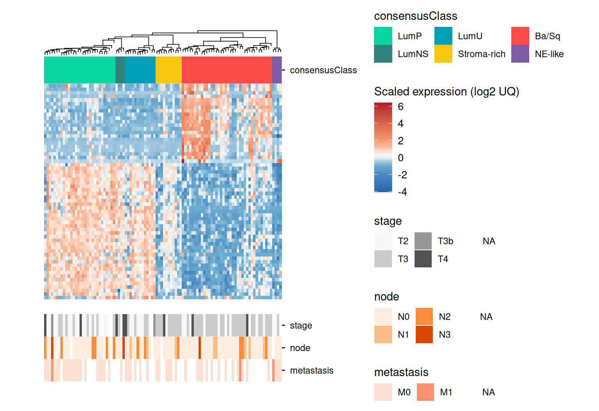

### Aligning new plots

Here we’ll make two different plots: one to align with the samples
(columns) and another to align with the genes (rows). We can get the
data from get_data, which is a good idea to facilitate further plotting
because it will ensure your observations will be in the correct order.
Then, here, we make a line-plot with the correlations of each sample to
the centroid of the 6 consensus bladder cancer subtypes. Note the use of
`theme_quant`, one of our suggested themes that look nice with
`ggheatmap`s, and that we switch the y-axis to the right side to make
the end-product look better (though everything will work without this).
Since we switched the y-axis to the right side, we also set `hjust = 0`
on `axis.text.y` so the axis text hugs the tick marks instead of leaving
a gap:

``` r
tcgaBLCA_tb2 <- get_data(gr_gghm)
plt_corlines <- tcgaBLCA_tb2 %>%
  ungroup() %>%
  select(observations, LumP:NE.like) %>%
  pivot_longer(cols = -observations, names_to = "subtype", values_to = "cor") %>%
  ggplot(aes(observations, cor, color = subtype, group = subtype)) +
  geom_line() +
  scale_y_continuous(position = "right") +
  scale_color_manual(values = c(`Ba.Sq` = "#fe4a49", LumNS = "#32837d", LumP = "#06d6a0", LumU = "#009fb7",
                                `Stroma.rich` = "#f9c80e", `NE.like` = "#7d5ba6")) +
  guides(color = "none") +
  labs(y = "Correlation\n to centroid") +
  theme_quant() +
  theme(axis.text.y = element_text(hjust = 0))
plt_corlines
```

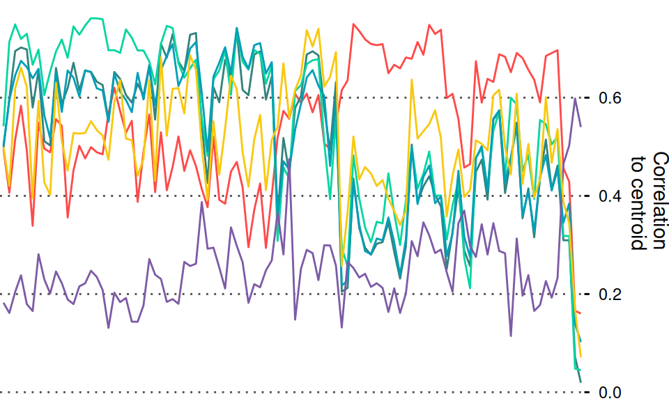

The second plot should align to the rows. We can’t just use the
`get_data` because it doesn’t contain the information to order our rows,
but we can get this from `get_rowLevels`. Here, we plot which signature
each gene in our example data belongs to:

``` r
plt_row_annot <- tcgaBLCA_ex$gene_annot %>%
  mutate(gene_symbol = factor(gene_symbol, levels = get_rowLevels(gr_gghm)),
         group = 'signature') %>%
  ggplot(aes(gene_symbol, group, fill = signature)) +
  geom_tile() +
  labs(y = "") +
  coord_flip() +
  theme_void()
plt_row_annot
```

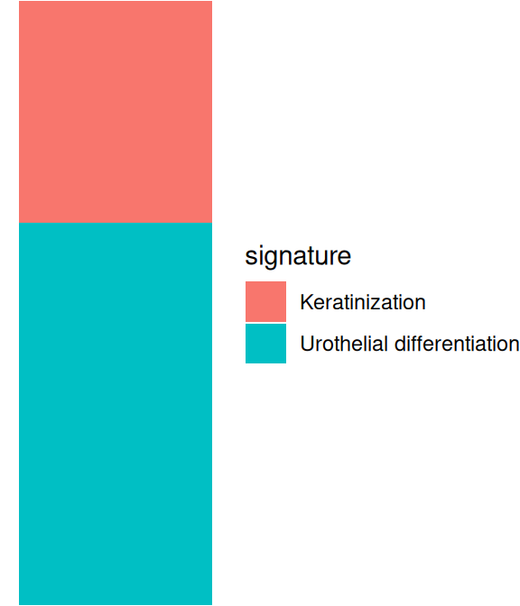

Finally, we can use `align_to_hm` to add these plots to the original hm
with all panels properly aligned. Note the use of
`legend_action = 'collect'` in the final call, that will unite all the
legends in a nice way.

When plots are stacked via `align_to_hm`, `patchwork` unions the widths
of the non-panel columns (axis text, axis title) that sit on the same
side across every stacked plot, so that panel edges all line up. That’s
normally what you want, but it means a right-side axis *title*, which is
otherwise a thin column, gets pushed out to match the width of the
widest thing sharing that side — here, the heatmap’s legends — landing
far away from its own tick labels. This can be worked around with
[`patchwork::wrap_elements()`](https://patchwork.data-imaginist.com/reference/wrap_elements.html),
but that comes at a real cost: it renders the plot to a fixed-size,
self-contained grob, so it stops taking part in `patchwork`’s panel
alignment altogether — the whole point of `align_to_hm`. A misplaced
axis title is a cosmetic issue you can tweak away; a panel that’s no
longer truly aligned defeats the purpose of the package, so we leave the
title where `patchwork` puts it:

``` r
gghm_complete <- gr_gghm %>%
  align_to_hm(plt_corlines, newplt_size_prop = 0.3) %>%
  align_to_hm(plt_row_annot, pos = "left", newplt_size_prop = 0.08,
              legend_action = "collect", tag_level = 'keep')
gghm_complete
```

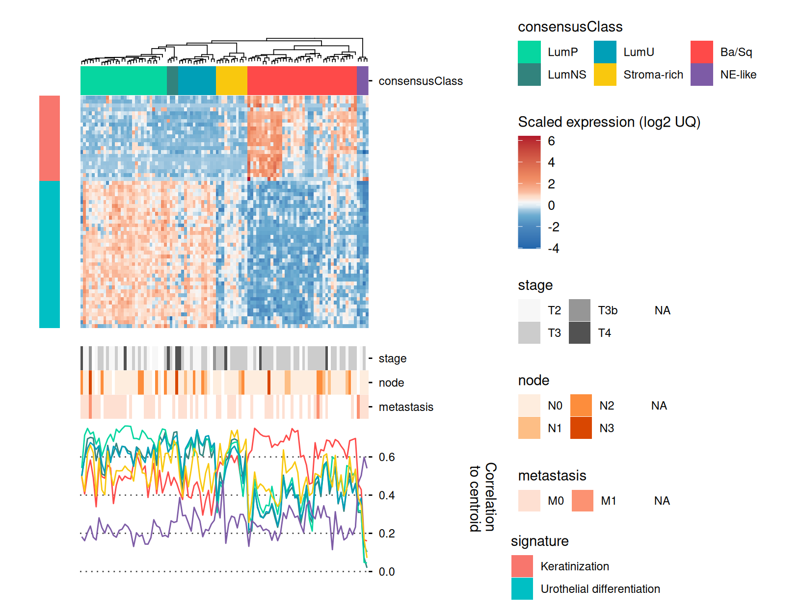

Note that you can still use the `patchwork` `&` to make global changes
to all plots:

``` r
gghm_complete <- gghm_complete &
  theme(legend.text = element_text(size = 7),
        legend.title = element_text(size = 8))
gghm_complete
```

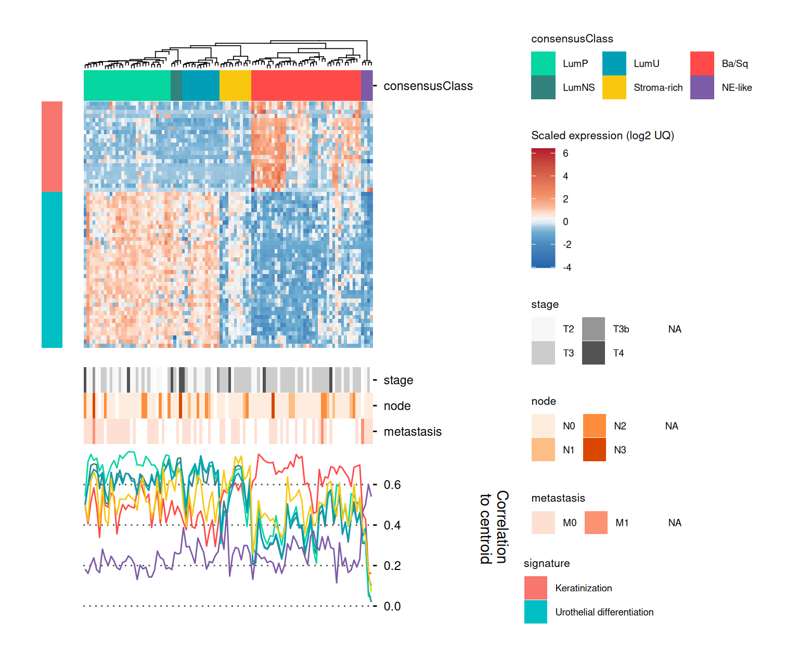

## Creating panels

You can now make panels with your complete heatmap with `patchwork`,
`cowplot` or other aligning packages. For example:

``` r
plt_subtype_count <- ggplot(sample_annot, aes(consensusClass, fill = consensusClass)) +
  geom_bar() +
  scale_fill_manual(values = c(`Ba/Sq` = "#fe4a49", LumNS = "#32837d",
                               LumP = "#06d6a0", LumU = "#009fb7",
                                `Stroma-rich` = "#f9c80e",
                               `NE-like` = "#7d5ba6")) +
  labs(y = 'Number of samples') +
  guides(fill = "none") +
  theme_quant() +
  theme(axis.ticks.x = element_line(color = "black"),
        axis.text.x = element_text(color = "black", angle = 45, hjust = 1, vjust = 1))

plt_subtype_count
```

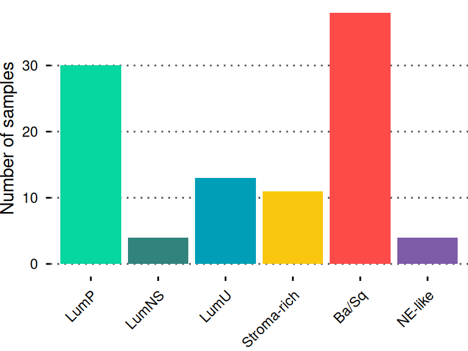

Then, we can just use standard `patchwork` to align the `ggheatmap` and
our new plots (as they won’t be aligned with the heatmap part of the
plot, but with the entire plot):

``` r
library(patchwork)
new_col <- (plt_subtype_count + plot_spacer()) +
  plot_layout(heights = c(0.3,0.7))

(new_col | gghm_complete) +
  plot_layout(widths = c(0.4,0.6))
```

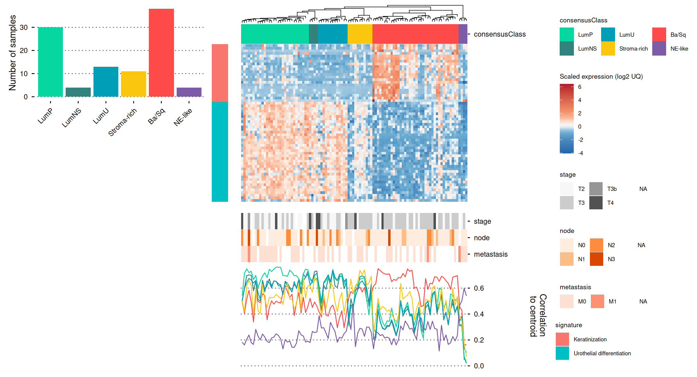

## Row facetting

As of ggheatmapper 0.1.2, we’ve added row facetting options using the
`rowv` parameter. ggheatmapper will render parts of the heatmap in
different facets if the `rowv` argument for the `ggheatmap` call is a
named list:

``` r
sig_list <- split(tcgaBLCA_ex$gene_annot$gene_symbol, tcgaBLCA_ex$gene_annot$signature)

gr_gghm <- ggheatmap(tcgaBLCA_tb,
    colv = "sample",
    rowv = sig_list,
    hm_colors = 'RdBu',
    hm_color_values = scales::rescale(c(-4,-2,-1,-0.5,-0.25,0,0.25,0.5,1,2,4,6)),
    scale = TRUE,
    center = TRUE,
    show_dend_row = FALSE,
    show_colnames = FALSE,
    show_rownames = FALSE,
    group_colors = c(`Ba/Sq` = "#fe4a49", LumNS = "#32837d", LumP = "#06d6a0", LumU = "#009fb7",
                     `Stroma-rich` = "#f9c80e", `NE-like` = "#7d5ba6"),
    colors_title = "Scaled expression (log2 UQ)")

gr_gghm +
  plot_layout(guides = 'collect')
```

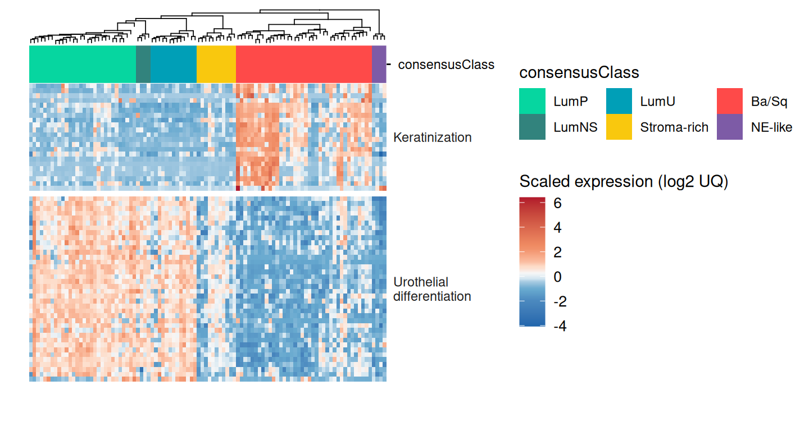
